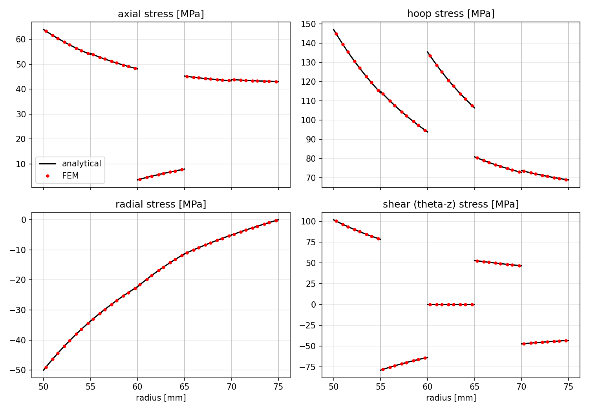
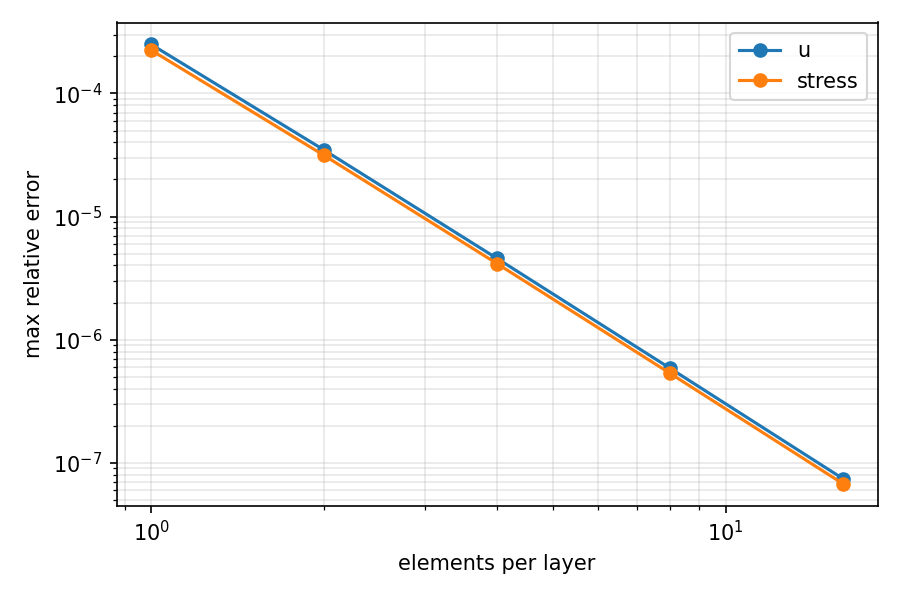
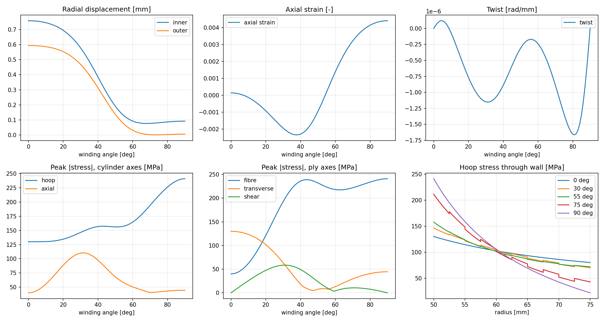
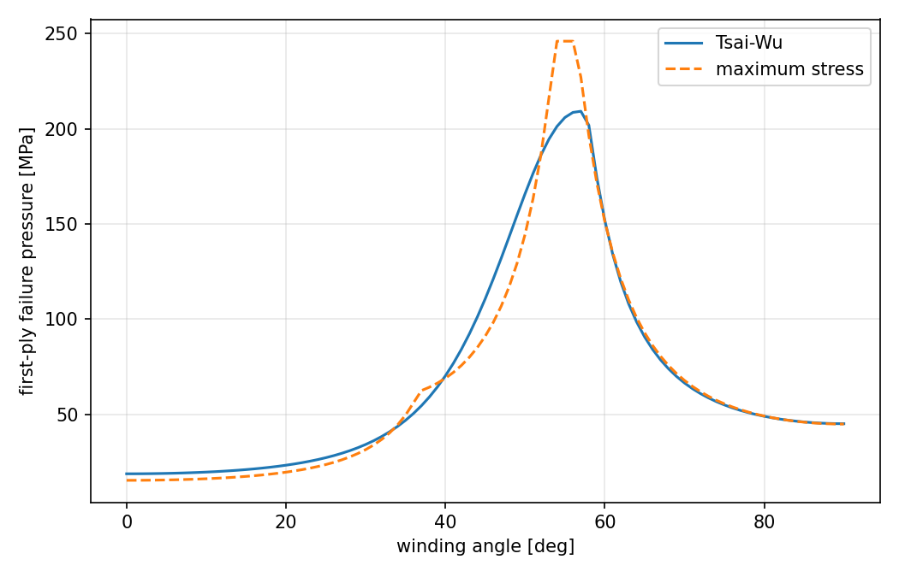

# Composite thick-walled cylinder

Layered, closed-end composite cylinder under internal/external pressure.
An analytical solution is compared with a 1D finite element model.

## Model
- Axisymmetric, generalised plane strain: u(r), axial strain e0, twist k
- Perfectly bonded, linear elastic, cylindrically orthotropic layers
- Ply angle measured from the cylinder axis (90 deg = hoop)
- Away from end effects; no thermal loads or failure prediction

## Analytical solution
In each layer, radial equilibrium gives

    u'' + u'/r - L^2 u/r^2 = (C12 - C13) e0 / (C33 r) + (C26 - 2 C36) k / C33
    L^2 = C22 / C33        (1 = axial, 2 = hoop, 3 = radial, 6 = shear)

The closed-form solution is `c1 r^L + c2 r^-L` plus particular terms
(logarithmic when L = 1 or 2). The constants, e0 and k follow from surface
pressures, interface continuity, axial force and zero torque. Resultant
integrals are evaluated by Gauss quadrature.

## FEM
Three-node quadratic elements in r, with e0 and k as global unknowns.

## Run
    pip install -r requirements.txt
    pytest
    python main.py

## Results

## Verification
All 11 tests pass. With 4 elements per layer:

| Quantity | Analytical | FEM |
|---|---|---|
| Inner radial displacement (mm) | 0.100329 | 0.100329 |
| Outer radial displacement (mm) | 0.040036 | 0.040036 |
| Axial strain | 1.09487e-3 | 1.09487e-3 |
| Twist (rad/mm) | -1.7800e-7 | -1.7800e-7 |

Maximum relative error falls from about 2.5e-4 (1 element per layer)
to about 7e-8 (16 elements per layer), approaching third-order convergence.

Case: inner radius 50 mm, layup [55/-55/90/55/-55] from inside out,
5 mm per layer, 50 MPa internal pressure, closed ends.
## Winding angle study
Ten alternating +a/-a layers (2.5 mm each), inner radius 50 mm,
50 MPa internal pressure, closed ends. Angle measured from the axis.

- **Radial displacement:** inner value falls from about 0.76 mm at 0 deg
  to a minimum of about 0.08 mm near 68 deg. Fibres increasingly carry
  hoop load; Poisson coupling helps place the minimum below 90 deg.
- **Axial strain:** reaches about -0.0023 near 38 deg, where hoop expansion
  causes strong axial contraction, and rises to about 0.0044 at 90 deg.
- **Twist:** zero at 0 and 90 deg and small elsewhere, because alternating
  layers nearly cancel each other.
- **Hoop stress:** peak rises from 130 MPa at 0 deg to about 241 MPa at
  90 deg, with more load concentrated near the inner surface.
- **Matrix-dominated stresses:** transverse and shear stresses are both
  low (roughly 15 MPa or less) around 55 deg.

No single angle is best for every measure. See the failure study below for a strength comparison.
## Failure study
First-ply failure pressure for the ten-layer +a/-a cylinder.
Run with `python failure_study.py`.

Assumed strengths (MPa): XT = XC = 1500, YT = 40, YC = 246, S12 = 68.
Radial strengths are taken equal to transverse strengths. These are
illustrative values, not a matched dataset for the elastic properties.

| Angle (deg) | Tsai-Wu (MPa) | Max stress (MPa) | Max stress mode |
|---|---|---|---|
| 0 | 18.8 | 15.4 | matrix tension |
| 30 | 34.2 | 31.5 | matrix tension |
| 45 | 110.7 | 91.1 | shear |
| 55 | 205.9 | 246.0 | radial compression |
| 75 | 55.0 | 55.6 | matrix tension |
| 90 | 45.1 | 44.9 | matrix tension |

- Tsai-Wu peaks at 209 MPa at 57 deg; maximum stress reaches 246 MPa
  around 54-56 deg, limited by the assumed radial compressive strength.
- The critical location moves from the inner layer at 55 deg and below
  (tabulated angles) to the outer layer at 60 deg and above.
- At 50 MPa, Tsai-Wu predicts first-ply failure for angles below about
  36 deg and above about 80 deg.
- These are first-ply estimates, not burst pressures. Thermal stresses
  and progressive damage are ignored.
